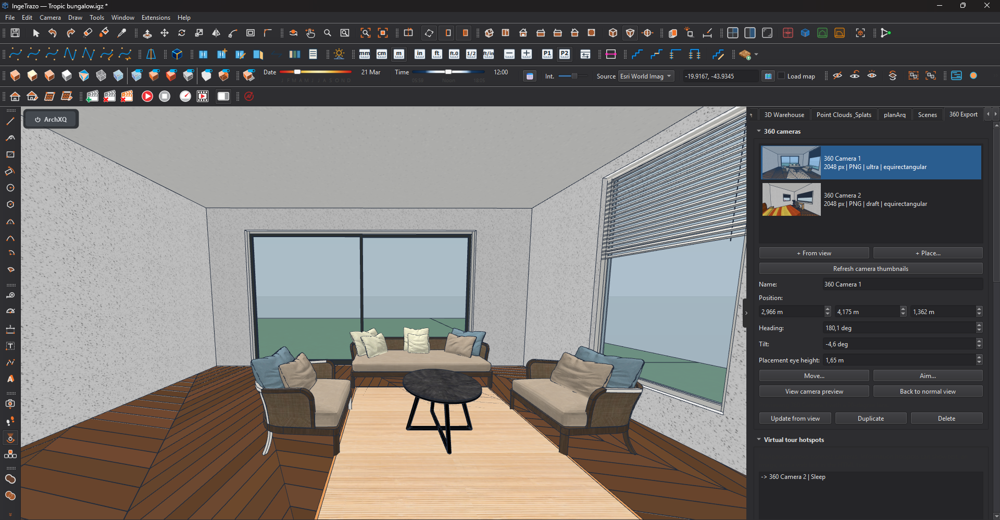
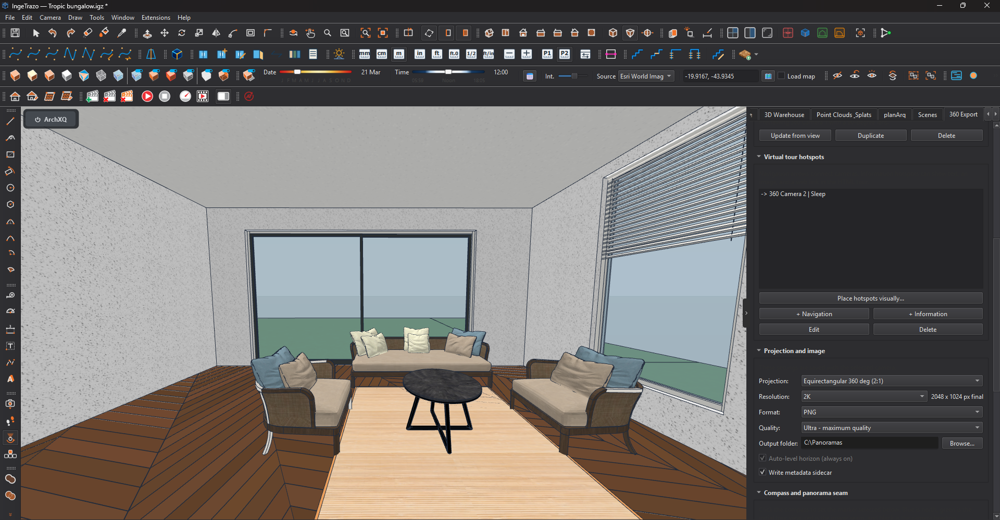
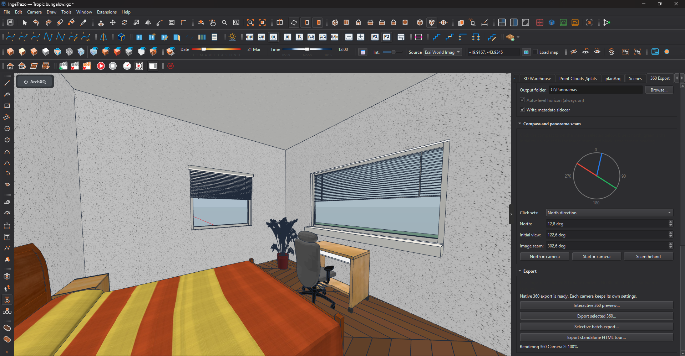
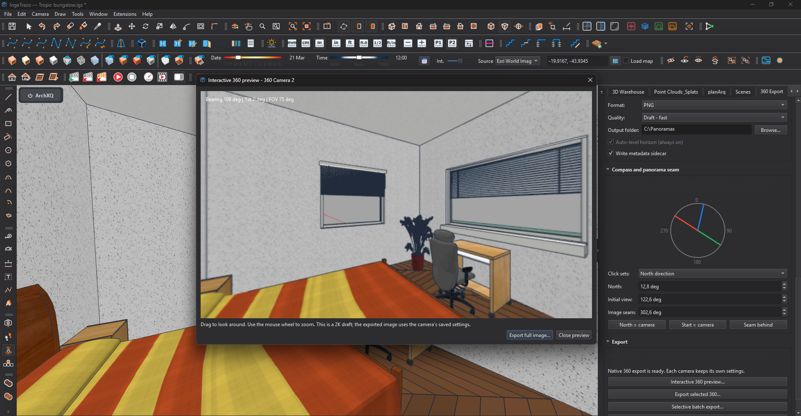
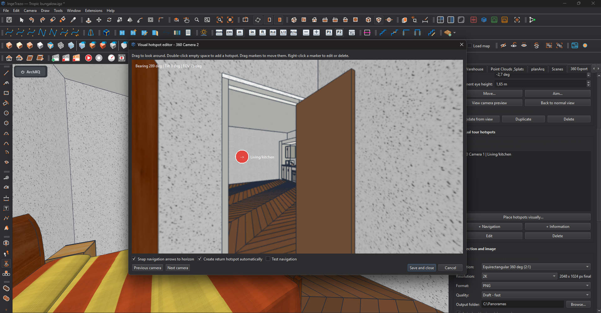
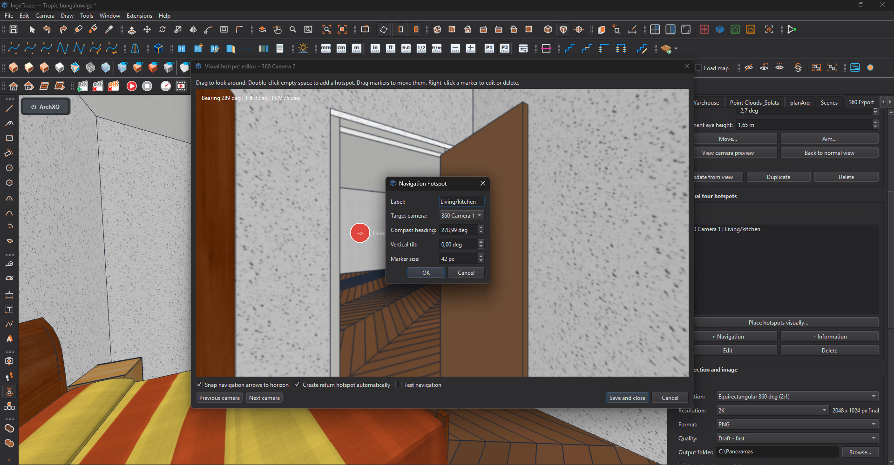
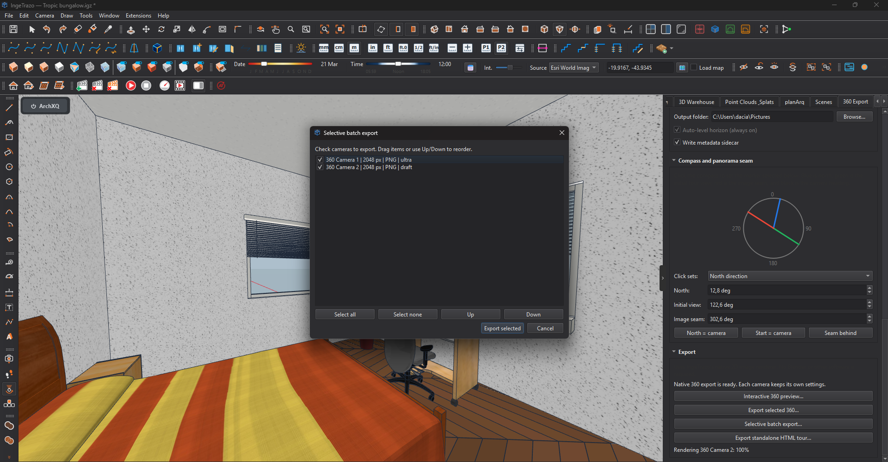

# IngeTrazo Native 360 Export — User Guide

This guide covers panorama cameras, image export, visual hotspots, virtual
tours, and batch export in Native 360 Export **v3.1.0**.

The plugin uses IngeTrazo's native renderer. Blender and other external
renderers are not required.

## 1. Open the plugin

1. Open an IngeTrazo model.
2. Click the red **360 Export** logo on the plugin toolbar, or choose
   **Extensions → Export 360 images…**.
3. The **360 Export** panel opens at the right side of the window.

The logo toolbar can be docked on any window edge or left floating.

## 2. Create a panorama camera

There are two ways to create a camera:

- **+ From view** — saves the current viewport eye position and direction.
- **+ Place…** — click a floor point in the model. The plugin adds the
  **Placement eye height** to that point.

For a natural standing view, an eye height around **1.60–1.70 m** is a good
starting point. Keep the camera away from walls and large furniture.

### Camera controls

- **Name** — use a clear room or location name.
- **Position** — precise X, Y, and Z coordinates.
- **Heading** — horizontal camera direction; 0° is north and 90° is east.
- **Tilt** — vertical direction used by the normal camera preview. The final
  panorama horizon is leveled automatically.
- **Move…** — click a new floor point for the selected camera.
- **Aim…** — click the point the camera should face.
- **View camera preview** — shows the selected camera with the same 90° lens
  used to capture each cube face.
- **Back to normal view** — restores the exact viewport used before preview.
- **Update from view** — replaces the selected camera position and direction
  with the current viewport.
- **Duplicate** — copies the camera, its export settings, and its hotspots.
- **Delete** — removes the camera and navigation links that point to it.

Select a camera in the gallery to edit it. Use **Refresh camera thumbnails**
after changing the model, materials, or camera positions.

> **Important:** Panorama cameras and their settings are saved in the `.igz`
> document. Save the IngeTrazo file after editing them.

## 3. Choose image settings

Expand **Projection and image**. These settings are stored separately for
every camera.

### Projection

| Projection | Result | Typical use |
|---|---|---|
| Equirectangular 360° (2:1) | One standard panorama image | Web viewers, social media, and tours |
| Cube map — six-face ZIP | Six square images in a ZIP | Engines and custom pipelines |
| Cube map — horizontal strip | Six faces in one row | Compatible real-time viewers |
| Cube map — 4 × 3 cross | Cubemap cross layout | Editing and conversion tools |

### Resolution and format

- **2K** is useful for fast tests and hotspot work.
- **4K–8K** is recommended for most final tours.
- **12K–16K** provides more detail but needs more memory and export time.
- **PNG** is lossless and produces larger files.
- **JPEG** is smaller and includes GPano metadata for compatible viewers.
- **Write metadata sidecar** creates an additional metadata file beside the
  exported image.

### Quality presets

| Preset | Best for |
|---|---|
| Draft | Fast placement and workflow tests |
| Standard | Balanced everyday export |
| High | Supersampled final images |
| Ultra | Maximum quality; slowest and most memory-intensive |

All presets use seam processing appropriate to their quality level. High and
Ultra render larger source faces and downsample them for a cleaner result.

Choose an **Output folder** for each camera before batch exporting.

## 4. Set north, start direction, and seam

Expand **Compass and panorama seam**.

The compass lines mean:

- **Black** — saved camera heading.
- **Blue** — north direction used by the tour.
- **Green** — initial direction shown when the panorama opens.
- **Red** — left/right seam of the equirectangular image.

To place a marker visually:

1. Choose **North direction**, **Starting direction**, or **Panorama seam** in
   **Click sets**.
2. Click the desired direction on the compass.

Useful shortcuts:

- **North = camera** aligns north with the camera heading.
- **Start = camera** opens the panorama facing the camera heading.
- **Seam behind** places the image seam opposite the camera heading.

Place the seam in a less important area when possible, such as a plain wall,
rather than across a doorway or detailed object.

## 5. Preview and export one panorama

1. Select a camera.
2. Confirm its projection, resolution, format, quality, and output folder.
3. Click **Interactive 360 preview…**.
4. Drag inside the preview to look around and use the mouse wheel to zoom.
5. Click **Export full image…** when satisfied, or close the preview and make
   adjustments.

You can skip the preview and use **Export selected 360…** directly. Choose the
destination filename when prompted. The panel displays progress, estimated
time remaining, and an **Open result** link after completion.

## 6. Build a virtual tour with visual hotspots

Create at least two panorama cameras before adding navigation links. Give the
cameras meaningful names such as *Lobby*, *Bedroom*, or *Terrace*.

Select a camera and click **Place hotspots visually…**. The plugin renders a
2K working panorama and opens the visual editor.

### Visual editor controls

- **Drag empty panorama space** — look around.
- **Mouse wheel** — zoom in or out.
- **Double-click empty space** — add a Navigation or Information hotspot at
  that exact heading and tilt.
- **Drag a marker** — reposition it; heading and tilt update automatically.
- **Right-click a marker** — edit or delete it.
- **Previous camera / Next camera** — continue editing the tour without
  returning to the main panel.
- **Save and close** — save the current camera's hotspot changes.
- **Cancel** — close without saving the current editor changes.

### Navigation hotspots

A navigation hotspot opens another panorama camera.

1. Double-click the doorway, corridor, or direction leading to the next room.
2. Choose **Place navigation hotspot**.
3. Enter a short label and choose the **Target camera**.
4. Adjust the precise heading, tilt, or marker size if needed.
5. Click **OK**.

Recommended options:

- Keep **Snap navigation arrows to horizon** enabled for level arrows.
- Keep **Create return hotspot automatically** enabled when you want the
  destination camera to receive a link back to the current camera.
- Enable **Test navigation**, then click a navigation marker to follow it.

The automatic return option applies when a new navigation hotspot is created.
It does not add duplicates when a return link already exists.

### Information hotspots

Choose **Place information hotspot** to add content rather than navigation.
An information hotspot can contain:

- A label
- Descriptive text
- A PNG, JPEG, or WebP image
- An optional web link
- Exact heading, tilt, and marker size

Information appears when the visitor clicks the blue **i** marker in the HTML
tour.

### Numeric hotspot controls

The main panel also provides **+ Navigation**, **+ Information**, **Edit**, and
**Delete**. Use these controls when you already know the exact compass heading
and vertical tilt or need precise final adjustments.

## 7. Export the standalone HTML tour

1. Verify every panorama in **Interactive 360 preview…**.
2. Test all navigation links in the visual hotspot editor.
3. Click **Export standalone HTML tour…**.
4. Choose an empty or dedicated output folder.
5. Wait for all cameras to render.
6. Click **Open result**, or open `index.html` in the selected folder.

The generated tour:

- Uses WebGL and requires no external JavaScript library.
- Embeds panorama and hotspot images as data URLs.
- Opens directly from disk; a local web server is not required.
- Includes camera selection, drag-to-look, wheel zoom, navigation markers,
  information panels, and optional links.

Keep the complete exported folder when sharing or archiving the tour.

## 8. Export several cameras

Click **Selective batch export…**.

1. Check the cameras to export.
2. Drag entries or use **Up** and **Down** to set the processing order.
3. Click **Export selected**.
4. During export, use **Pause**, **Resume**, or **Cancel** as needed.

Each camera uses its own saved projection, resolution, format, quality, and
output folder. If a selected camera has no output folder, the plugin asks for
a fallback folder.

## 9. Recommended first-tour workflow

1. Place one camera in each room or important viewpoint.
2. Name every camera clearly.
3. Preview the 90° camera direction and refresh thumbnails.
4. Use Draft or 2K settings while building the tour.
5. Set north, initial direction, and seam for each camera.
6. Add and test navigation hotspots in both directions.
7. Add information hotspots where useful.
8. Run an interactive preview for every camera.
9. Change final cameras to Standard, High, or Ultra and the required
   resolution.
10. Export the HTML tour or a selected batch.
11. Open and test the final files before publishing.

## 10. Troubleshooting

### The panorama starts in the wrong direction

Change **Initial view**, or select **Starting direction** and click the desired
direction on the compass.

### A seam crosses an important object

Move **Image seam**, or use **Seam behind**, then preview again.

### A navigation marker is not visible

Open the visual editor and look around the complete panorama. Drag the marker
into view or edit its heading and tilt numerically. For normal room-to-room
navigation, enable horizon snapping.

### Batch export asks for another folder

One or more selected cameras has no saved output folder. Choose a fallback,
or set an output folder separately for every camera.

### Export is slow or uses too much memory

Use a lower resolution or quality preset. Draft and 2K are intended for test
exports; switch to final settings only after camera and hotspot approval.

### The HTML tour shows a black image

Export the tour again with v3.0.1 or later. Current releases embed images in
`index.html` so tours work when opened through `file://`.

## Compatibility

- IngeTrazo 0.5.7 or later
- Extension API 2
- Windows

Created by **D.S (Archviz360)**. Licensed under GPL-3.0-or-later.
